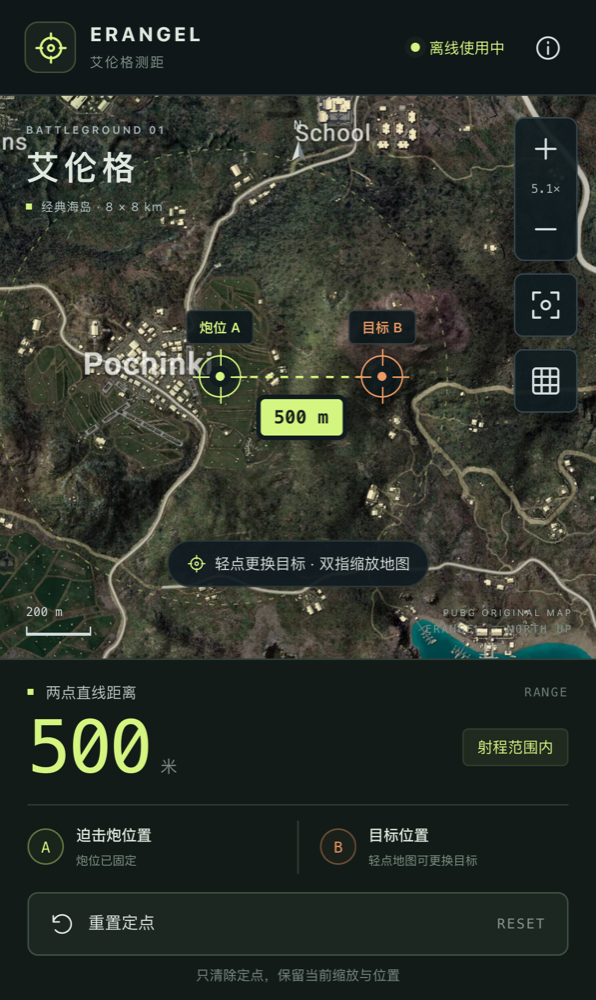

# 艾伦格离线测距 PWA 交付记录

日期：2026-10-23

## 使用

访问地址：[艾伦格测距](https://yungzzhh.github.io/pubgmap/)。

源码仓库：[Yungzzhh/pubgmap](https://github.com/Yungzzhh/pubgmap)。

1. 联网打开网页，等待右上角显示「离线就绪」。
2. iPhone 用 Safari 的分享菜单选择「添加到主屏幕」；Android 用 Chrome 菜单选择「安装应用」或「添加到主屏幕」。
3. 从主屏幕打开一次，再次确认离线状态后即可断网使用。
4. 轻点炮位 A，再轻点目标 B，立即显示距离；以后轻点只更换目标。
5. 单指拖动、双指缩放；「重置定点」只清除两点和结果，不改变地图视角。
6. 「查看完整地图」按钮恢复全图视角；网格按钮显示 1 km 网格，放大后细分为 100 m。

浏览器或系统清理站点数据后，需要重新联网缓存。安装后的浏览器缓存空间由系统管理，不能承诺永久保留。

## 本地开发

```sh
npm ci
npm test
npm run dev
```

生产预览（包含离线功能及真实子路径）：

```sh
npm run build
npm run preview -- --host 127.0.0.1 --port 4173 --strictPort --base=/pubgmap/
```

开发服务器不包含生成的 `sw.js`；离线验收请使用生产预览或线上 HTTPS 地址。

推送 `main` 后，GitHub Actions 会执行 `npm ci`、测试和生产构建，然后部署 GitHub Pages。

## 地图来源与计算依据

- 官方来源：[pubg/api-assets](https://github.com/pubg/api-assets)，文件 `Assets/Maps/Erangel_Main_High_Res.png`。
- 原图为 8192×8192 PNG，94,773,167 字节；SHA-256：`5dc33eac3af60b375cb0e29b7648132dbaa164c75c0310368e8ae585bcbecc45`，已与 Git LFS 指针核对一致。
- 手机资源为等比例 4096×4096 WebP，约 2.4 MB；SHA-256：`c2e16dc59656ebaaedb9eb7f64a5e55208a270e74ae3ba297e00fff1015d4b2c`。
- 地图坐标采用 819200 厘米，即边长 8192 米；参考 [chicken-dinner 的 map_dimensions](https://github.com/crflynn/chicken-dinner/blob/master/chicken_dinner/constants.py)。这是社区坐标换算资料，未宣称游戏内实测校准。
- 使用归一化地图坐标计算欧氏距离，最后换算为米；图像压缩、平移及缩放均不改变距离。
- 结果只表示地图水平直线距离，不含高差、弹道和游戏内版本变动校正。121–700 米为迫击炮参考射程提示。
- 地图版权归 KRAFTON，素材的使用遵循官方仓库链接的 Terms of Use 与 Player-created Content 规则。

## 新鲜验证证据

- TDD 首次运行：三个实现模块缺失，测试失败；实现后 12 项通过。
- 离线恢复补充测试先失败，确认「缓存缺失后重试」未恢复资源；修复后通过。另补充断网启动测试，确保使用已安装的 Service Worker，不因在线更新注册失败误报缓存状态；共 16 项测试通过。
- `npm run build`：TypeScript 检查和 Vite 生产构建通过；全部 10 项本地静态资源纳入预缓存。
- `npm audit --omit=optional`：0 vulnerabilities。
- Chromium 浏览器以实际鼠标及 CDP 多点触摸验证：已知 500 米、缩放和平移后距离不变、Reset 视角字符串严格相同、双指缩放后无标记。
- 断网刷新与同上下文新页面冷启动成功；地图 4096×4096 完整加载，断网测距显示 500 米，状态为「离线使用中」。
- 320×568、360×640、390×844、430×932、844×390、1365×900 布局检查通过：无页面溢出，重置按钮可见。
- manifest 解析无错误；独立持久化 Chromium profile 的 `Page.getInstallabilityErrors` 返回空数组，PWA 安装条件检查通过。
- 在独立测试 profile 中删除本应用地图缓存后，页面如实显示「缓存未完成」；点击「重新准备离线缓存」恢复地图资源并返回「离线就绪」。
- WebKit 的 iPhone 15 模拟环境：触摸定点、Reset 保持视角、断网刷新和地图加载通过；393×659 无溢出，未出现页面错误。触摸落点的像素量化测试显示 497 米，在 500 米目标的 5 米容差内。

## 发布与验收边界

发布：完成。

首次 GitHub Actions 运行的测试、类型检查和生产构建均通过，但 `configure-pages` 读取站点返回 404。已通过 API 启用 Pages 的 workflow 发布方式，并为构建任务显式授予 `pages: read`，随后重新发布验证。

- 功能提交：`bd501dbb076b6f572d05ac510e5c35ce743ec9fe`。
- [GitHub Actions 39891818902](https://github.com/Yungzzhh/pubgmap/actions/runs/39891818902)：16 项测试、类型检查、生产构建、build 与 deploy 均成功。
- 线上页面 HTTP 200；初始发布全部 10 个静态资源逐项与本地产物进行 SHA-256 比对一致；最后更新的 `index.html`、JavaScript 与 `sw.js` 再次独立回读，比对一致。
- 最新离线缓存版本：`5e5b47dce71cfba2`；Service Worker SHA-256：`b30ad228f59bd5d1a3740c8c8dffd476fd3124fa6a03f07e245b0875c0d51297`。
- 实际线上地址的 Chromium iPhone 模拟环境：500 米测距、Reset 保留视角、原生双指触摸、manifest 解析通过；断网后刷新和新页面冷启动成功，地图完整加载，仍能测出 500 米，未出现页面 JavaScript 错误。



尚未代替用户完成真实 iPhone / Android 主屏幕安装，以及游戏内已知点位距离对照验收。
