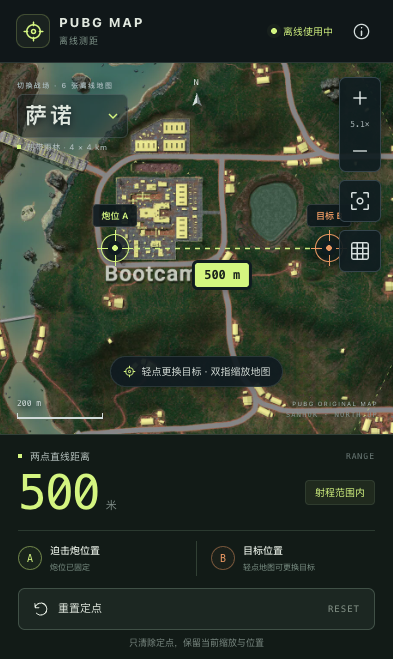

# 多地图测距 v1.1

日期：2026-10-26

## 变化与使用

在原艾伦格之外增加用户确认的五张地图：米拉玛、萨诺、维寒迪、泰戈和帝斯顿。

点击地图左上角名称即可切换；每张地图独立保存本次打开期间的定点和视角，重新打开时记住上次所选地图。Reset 只清除当前地图定点及距离，保留缩放和平移。

部署地址沿用 [PUBG 离线测距](https://yungzzhh.github.io/pubgmap/)。现有 PWA 无需重新安装，联网打开以下载更新。首次更新约需缓存 17 MB；下载完成后刷新，看到「6 张离线地图」入口及「离线就绪」后即可断网切换全部地图。下载期间保留原版离线缓存，不需要清除浏览器数据。

## 距离与素材

| 地图 | 通常地图规格 | 坐标边长 |
| --- | --- | --- |
| 艾伦格 | 8×8 km | 8192 m |
| 米拉玛 | 8×8 km | 8192 m |
| 萨诺 | 4×4 km | 4096 m |
| 维寒迪 | 新版 8×8 km | 8192 m |
| 泰戈 | 8×8 km | 8192 m |
| 帝斯顿 | 8×8 km | 8192 m |

归一化坐标的距离乘以当前地图边长；网格、比例尺和 700 米参考圈同步使用该边长。萨诺不能沿用艾伦格的比例，维寒迪不沿用旧版 6×6 km 的坐标换算。

素材来自 [PUBG 官方 API 素材仓库](https://github.com/pubg/api-assets/tree/master/Assets/Maps)。新增五张原图均为 8192×8192 PNG，已逐张与官方 Git LFS 的 SHA-256 校验一致；手机资源等比例压缩为 4096×4096 WebP，六张合计 17,066,040 字节，约 16.3 MiB。萨诺的原图分辨率与地图坐标边长分别配置。

完整来源、原图哈希及压缩资源哈希见 [素材校验记录](./2026-10-26-map-assets.json)。地图版权及素材使用边界沿用原版，结果仍为地图水平直线距离，不包含游戏地形高差、弹道修正或真机游戏点位校准。

## 验证

- TDD：地图模块缺失、切换取消手势缺失、构建前素材检查缺失分别先确认失败，再实现；23 项单元测试通过。
- TypeScript 检查和生产构建通过；构建前检查全部六张地图存在，15 个静态资源完整预缓存。
- 六张地图分别通过浏览器已知坐标的 500 米测距、网格边长、700 米参考圈和 Reset 视角不变检查。
- 切换后各地图状态独立并可恢复；刷新后记住上次所选地图。
- 320×568、390×844、844×390、1365×900 均无页面溢出，地图选择器实际命中测试通过，Reset 可触达。
- 加载遮罩挡住地图选择器的问题先通过阻塞图片请求复现，再修复；加载未完成时也可以选择其他地图。
- Chromium 离线：六张地图均显示 500 米，断网刷新及新页面冷启动通过。
- WebKit iPhone 15 模拟环境离线：六张地图的触摸定点均显示 499 米，在 500 米样例的 5 米触摸量化容差内；断网切换、刷新和冷启动通过。
- 最终缓存版本 `f079dd08383da820`，共 15 项本地资源；正式预览两种浏览器均加载最终构建 `index-Dat72X4B.js`。

## 发布

状态：已发布。

- 功能提交：`cc5b812a759e04b5a950074263d8979c48c8eb3d`。
- [GitHub Actions 40266062956](https://github.com/Yungzzhh/pubgmap/actions/runs/40266062956) 成功完成 23 项测试、类型检查、生产构建及 Pages 发布。
- 在实际 HTTPS 地址从缓存版本 `5e5b47dce71cfba2` 升级至 `f079dd08383da820`，未清除站点数据；下载完整后刷新可见六张地图。
- 对实际线上缓存的全部 15 个资源独立计算 SHA-256，与本地生产产物逐项一致。
- 实际线上六张地图均通过在线 500 米测距及 Reset 保持视角验证；断网刷新后，六张地图再次均测出 500 米，新页面冷启动仍可加载并记住上次所选帝斯顿地图。

手机主屏幕安装及真实游戏点位对照仍需要真实设备验收。
