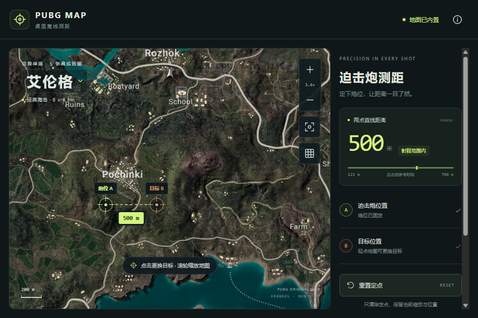

# Windows 便携版 v1.2.0

日期：2026-10-26

交付校验完成：2026-10-27

## 使用

目标平台：Windows 10 / 11 x64。

1. 将 `PUBG-Rangefinder-1.2.0-win-x64-portable.zip` 复制到 Windows 电脑，完整解压到可写文件夹。
2. 双击 `PUBGRangefinder.exe` 即可使用，保留同目录下的 DLL、资源和其他运行文件。
3. 六张地图已经内置，首次启动即可完全离线。点击左上角地图名称切换，点击炮位和目标测距；按住拖动，滚轮或双指缩放。
4. 「重置定点」只清除当前地图的点和距离，保留缩放与平移；每张地图在本次打开期间保留各自状态。
5. 所选地图记录保存在 EXE 旁的 `data/`。移动或更新便携版时，请保留这个文件夹。

独立 Electron 桌面窗口，无须安装 Node.js、浏览器或启动本地服务。未配置开发者代码签名。

## 构建与验证

- 桌面源码分支：`codex/windows-portable`；交付源码提交 `e6d736caafdde11b410a997a44d52bb6b75bf960`。
- Electron 45.0.0、electron-builder 26.18.0；运行时和六张地图都放入便携包。
- 新增桌面资源边界、完整性、中文路径、数据目录和离线模式的失败测试后实现，最终共 30 项测试通过。
- TypeScript、桌面构建、既有构建和桌面界面预览通过；预览验证不替代 Windows EXE 验收。
- [Windows Actions 40310134864](https://github.com/Yungzzhh/pubgmap/actions/runs/40310134864) 成功完成 Windows 构建、ZIP 打包及解压后 EXE 启动验证。
- EXE 在含中文和空格的路径 `PUBG 中文便携 测试` 下实际运行，工作目录独立于程序目录。
- 启动测试禁用外部 DNS，六张地图均完整加载并测得 500 米；Reset 前后视角完全相同。
- 实际打包应用的 `sandbox=true`、`contextIsolation=true`、`nodeIntegration=false`、`webSecurity=true`，渲染进程没有 Node `require`，外部网络请求被拒绝。
- 没有注册 Service Worker，界面没有 PWA 安装流程；原生进程退出后重新运行仍选中上次的帝斯顿。
- 便携数据真实写入 EXE 旁的 `data/`，验收过程未使用系统级安装或启动项。

完整启动验收结果见 [verification.json](./windows-portable/verification.json)。

## 交付文件

Windows 运行文件：[下载便携版 Artifact](https://github.com/Yungzzhh/pubgmap/actions/runs/40310134864/artifacts/12644571120)（GitHub 下载需要登录，保留期 90 天）。

本机交付文件：`docs/changes/windows-portable/PUBG-Rangefinder-1.2.0-win-x64-portable.zip`。文件为 178,587,062 字节，约 170.3 MiB；ZIP 保存在项目内，不提交至 Git，GitHub 用户可从上方 Artifact 下载同一成品。

2026-10-27 完成独立校验：

- SHA-256：`e3fed26ecb5a89fe2cc0fc392617b6e1595f9a244c555469d9923440dbfbf7c2`，与 GitHub artifact 摘要一致。
- 72 个 ZIP 条目 CRC 校验通过，EXE 位于压缩包根目录，没有随包分发个人 `data/`。
- EXE 为 PE32+、AMD64（`0x8664`），证书表为空，确认是未签名的 Windows x64 程序。
- ASAR 内 14 个资源逐项校验通过，六张地图字节与项目原图资源一致；桌面主进程及策略模块与交付源码提交一致，应用版本为 1.2.0。

详见 [压缩包校验记录](./windows-portable/archive-verification.json) 及 [SHA-256 文件](./windows-portable/PUBG-Rangefinder-1.2.0-win-x64-portable.zip.sha256)。

Windows 构建环境的 EXE 启动和功能检查已经完成；用户游戏电脑的显卡、缩放比例及系统提示仍以真实设备使用为准。
