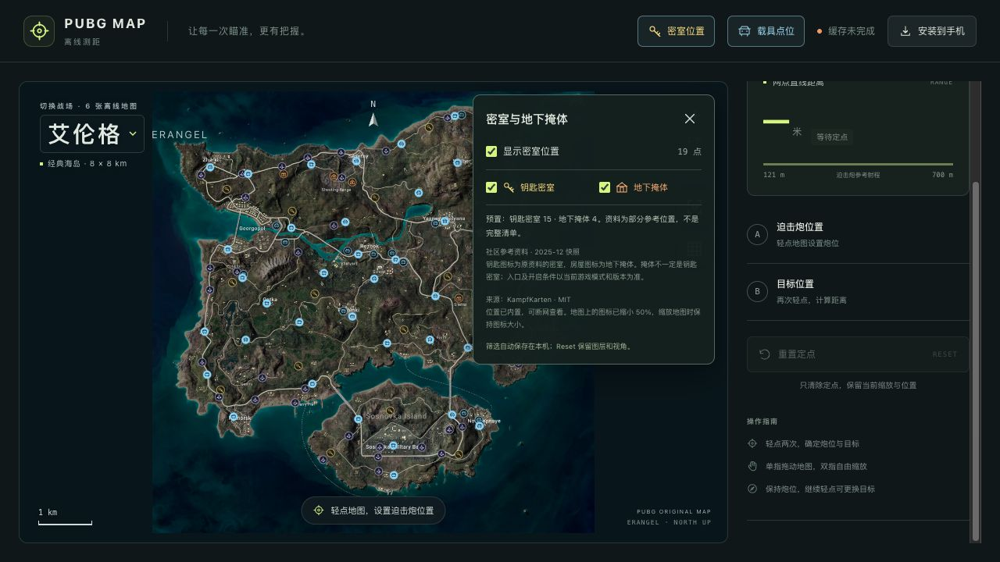

# 网页 v1.4.1：修复旧离线页面没有切换到新版

日期：2026-10-27

## 原因

GitHub Pages 已部署最新代码，但实际浏览器首次打开仍显示 ERANGEL、BATTLEGROUND 01、v1.0，没有地图选择、载具和密室入口。旧 Service Worker 对导航采用缓存优先，新缓存接管后只检查离线状态，没有提醒页面切换版本。网页页脚也一直保留旧的 v1.0 文案。

## 调整

- 联网导航优先获取新页面，跳过普通 HTTP 缓存；断网、服务器异常或网络探测超过 3 秒时回退到完整离线页面。
- 不将新 HTML 写入旧版本缓存，避免混用不同版本的脚本与页面。
- 新客户端检查自身页面脚本是否属于完整缓存；不能只因旧 worker 报告旧缓存完整就提示新页面已离线就绪。
- 未来版本缓存完成后显示「更新页面」，用户主动点击后刷新；提示明确说明本次测距定点会清除，已保存载具点仍保留。不会在测距中自动刷新。
- 点击右上角离线状态打开说明，可使用「检查并获取更新」。联网恢复和重新聚焦页面时也会检查；重复检查会清理旧监听，避免重复回调。
- 网页版本显示为 v1.4.1；Windows 便携包仍使用已发布的 v1.4.0，不替换该发行资产。
- 不清除 localStorage、载具自记点、筛选或其他站点数据。

## 验证

- 先通过失败测试复现导航返回旧页面、缺少更新通知、旧缓存错误报告新页面就绪；实现后 48 项单元测试通过。
- 类型检查、网页构建和桌面构建通过。
- 本地浏览器使用真实 Service Worker 完成双版本升级。模拟的 v1.4.2 只用于测试，没有部署或发行。
- 新版通知前后的测距结果均为 499 米，页面没有自动刷新。主动更新后，自记汽车 1 点、飞机关闭筛选、上次选中的萨诺地图仍保留。
- 测试服务器返回 503 时，六张地图均从离线缓存加载，图像宽度均为 4096。
- 详见 [本地验收记录](./pwa-update/local-verification.json) 和 [更新通知测试截图](./pwa-update/update-notice-fixture.png)。

## 使用旧版本的设备

首次迁移需要联网刷新，让旧版切换到当前网页。桌面浏览器可用 Windows Ctrl+F5 或 macOS Cmd+Shift+R 强制刷新，无需清除网站数据。新版右上角显示「载具点位」「密室位置」，页脚显示 v1.4.1 网页版。

手机主屏幕 PWA 的真实系统缓存行为仍需在对应设备验证；本轮浏览器验收不等同于手机真机验收。

## 部署

状态：已部署并核对线上新版页面。

- 修复源码：5a5bb36416ac31fda6eab16442e02199f308823e。
- [Pages 构建与部署 40482008834](https://github.com/Yungzzhh/pubgmap/actions/runs/40482008834) 成功。
- [Windows 回归构建与实际 EXE 验收 40482008870](https://github.com/Yungzzhh/pubgmap/actions/runs/40482008870) 成功；未替换已发行的便携包。
- 线上 HTML、JS、CSS、Service Worker 与本次本机构建一致，缓存版本 ae8f15dee00a4f9d；见 [部署核对](./pwa-update/deployment.json)。
- 旧浏览器首次普通刷新仍可能命中旧页面。实际验收临时绕过 Service Worker 和 HTTP 缓存，并保持到新版脚本加载完毕；随后恢复正常缓存设置。未删除任何站点存储。
- 实际浏览器已显示 PUBG MAP、六图切换、「密室位置」「载具点位」及 v1.4.1 网页版。截图时六图首次缓存尚未完成，不把这一步报告为线上断网验收通过；完整离线回归见前述本地双版本测试。

