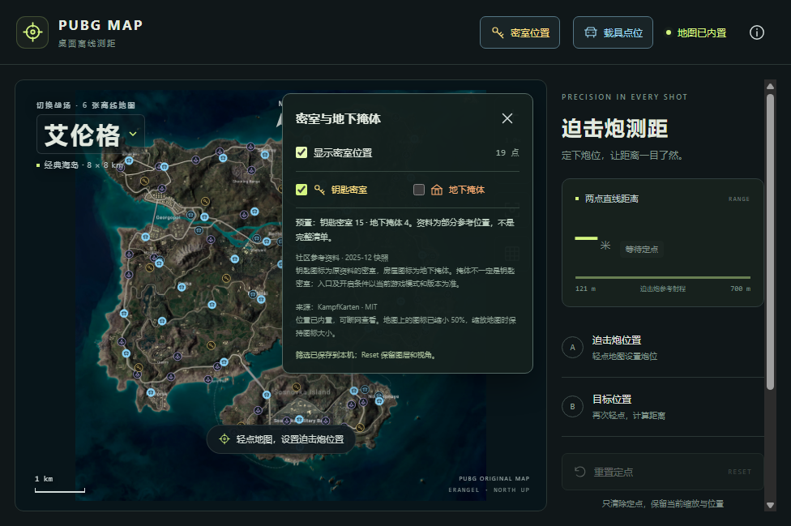

# Windows v1.4 密室位置与小图标

日期：2026-10-27

## 使用

右上角点「密室位置」，分别勾选「钥匙密室」和「地下掩体」。金色钥匙与橙色房屋标记分别表示两类位置。地图上的汽车、飞机、密室及掩体图标已整体缩小 50%，可继续直接点击对应位置测距。

密室筛选自动保存到本机，和载具筛选相互独立。Reset 只清测距定点，保留当前视角、图层与自记载具记录。更新应用时保留 EXE 旁的 data 文件夹。

## 数据范围

| 地图 | 钥匙密室 | 地下掩体 |
| --- | --- | --- |
| 艾伦格 | 15 | 4 |
| 米拉玛 | 0 | 3 |
| 萨诺 | 0 | 0 |
| 维寒迪 | 0 | 10 |
| 泰戈 | 15 | 0 |
| 帝斯顿 | 13 | 0 |

共 60 个位置。来源：[JanJastrow/KampfKarten](https://github.com/JanJastrow/KampfKarten)，MIT 许可，2025-12 社区快照，2026-10-27 在线核对。原类型 secret_room 与 bunker 保持区分，不把掩体当作必需钥匙的密室。资料不是完整清单，0 表示暂无该类型预置数据；入口及开启条件以当前游戏版本、模式为准。

源码导入脚本保留源文件 Git blob 和 SHA-256 并校验后转换坐标，详见 [来源记录](./secret-rooms/data-sources.json)。MIT 许可随程序的 maps/vehicle-data-LICENSE.txt 分发。

## 验证与交付

状态：已交付 Windows v1.4.0 x64 便携版。

- TDD 首次因缺少 room-data.ts 失败，新增实现后共 43 项单元测试通过。
- 桌面、网页构建与类型检查通过。
- 实际界面验证六地图测距、7 px 图形视口、10 px 底圈、独立密室/掩体筛选、图标处测距、缩放定位及刷新恢复。
- 首次 Windows 构建和六图 500 米测距通过；尺寸检查发现 Playwright boundingBox 包含描边，几何直径须用 DOM 边界测量。已在本地复现并修正验收脚本，第二次 Windows 完整验收通过。

- [Windows Actions 40475600761](https://github.com/Yungzzhh/pubgmap/actions/runs/40475600761) 成功；源码 e6ff5ec1d3d7ca4f9cac5ec1f8822ed0bde634fb。

## 便携版

Windows 10/11 x64，完整解压后运行 PUBGRangefinder.exe。更新时先退出应用，将旧版 EXE 旁的 data 文件夹保留并放在新版 EXE 旁，即可继续使用原来的载具记录和筛选。程序为未做数字签名的便携版。

- [GitHub 构建产物下载](https://github.com/Yungzzhh/pubgmap/actions/runs/40475600761/artifacts/12720168337)（需要登录，产物保留 90 天）。
- [Windows 实际 EXE 验收记录](./secret-rooms/verification.json)：禁用外部 DNS 首次启动，六图分别测距 500 米，独立密室筛选，7 px 图形视口、10 px 几何底圈，图标处测距、Reset 保留及完整退出重开恢复均通过。
- 载具仍为原 257 个社区点，自记点使用原存储格式；新增密室筛选不重写载具数据。

## 本机文件与独立校验

- [PUBG-Rangefinder-1.4.0-win-x64-portable.zip](./secret-rooms/PUBG-Rangefinder-1.4.0-win-x64-portable.zip)：178,607,024 字节，约 170.3 MiB，保存在项目内，ZIP 不提交 Git。
- SHA-256：f48e69199e80ad981d922ea0a5c4ace9e2e246ff85b3a05a999b2ad09aeb2138，与 GitHub artifact 摘要一致；见 [SHA 文件](./secret-rooms/PUBG-Rangefinder-1.4.0-win-x64-portable.zip.sha256)。
- [独立包校验](./secret-rooms/archive-verification.json)：72 条目 CRC、Windows x64 PE、15 项内置资源哈希、六图原始字节、257 个载具点及 60 个密室/掩体点标识均通过。MIT 全文完整保留，未包含个人 data 文件夹。
- 主进程、隔离策略及许可文本与源码比较时仅将 Windows CRLF 换行规范为 LF；二进制地图按原始字节比较。
- 代码审查核对图层不截获点击、缩放只影响图案、保存失败不改内存状态、密室存储与旧载具记录隔离。实际游戏版本与模式对入口和开启条件的影响仍以游戏为准。
