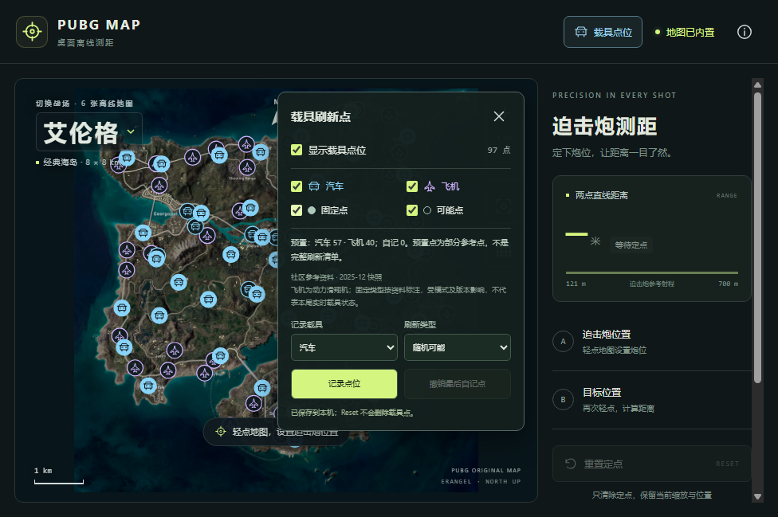
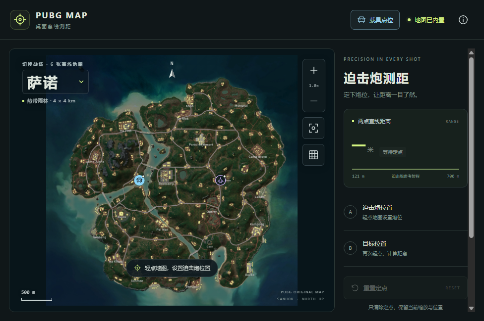

# Windows v1.3 载具刷新点

日期：2026-10-27

## 使用

右上角「载具点位」打开设置。蓝色汽车图标与紫色飞机图标分别表示汽车及动力滑翔机，实心为固定点、空心为可能点。可分别筛选车型和刷新类型，也可关闭整个图层。

选择「记录载具」和「刷新类型」后，点「记录点位」进入记录模式，再点击地图添加。可连续添加，点「结束记录」或按 Esc 恢复测距；切换地图也会结束记录。载具标记不会阻挡原测距点击。

自记点和筛选自动保存在便携应用的 data 目录所对应的本地存储，退出再开仍保留。「重置定点」只清测距点，不删除载具记录；「撤销最后自记点」只移除当前地图最后一个用户记录。

升级时保留旧版本的 data 文件夹。已有地图、定点操作及离线使用方式保持原有行为。

## 预置资料的范围

| 地图 | 汽车 | 飞机 | 总计 |
| --- | --- | --- | --- |
| 艾伦格 | 57 | 40 | 97 |
| 米拉玛 | 42 | 40 | 82 |
| 萨诺 | 0 | 0 | 0 |
| 维寒迪 | 24 | 10 | 34 |
| 泰戈 | 24 | 10 | 34 |
| 帝斯顿 | 0 | 10 | 10 |

共 257 个社区参考点，不是完整或实时载具清单。萨诺暂无可靠预置资料，帝斯顿暂无汽车预置资料；六张地图均可手工补记。

来源为 [JanJastrow/KampfKarten](https://github.com/JanJastrow/KampfKarten)，MIT 许可，2025-12 快照，2026-10-27 核对。固定汽车采用原资料 car_fixed，车库点及动力滑翔机采用可能刷新类型；实际游戏模式、版本及本局车辆状态以游戏为准。

源数据的 y 不是本项目的线性像素 y，已根据源 Leaflet EPSG3857 映射转换到归一化底图位置。剔除一个空坐标及一个完全重复点，未补造坐标。源文件 Git blob 与 SHA-256、去重及剔除记录见 [来源校验记录](./vehicle-spawns/data-sources.json)。MIT 全文随应用的 vehicle-data-LICENSE.txt 保存。

## 验证

- TDD 首次因 vehicles.ts、vehicle-data.ts 缺失失败，随后实现；最终 39 项测试通过。
- 验证坐标转换、车型/刷新筛选、跨地图隔离、屏幕投影、本地存储恢复、无效数据保留及撤销范围。
- 桌面界面验证：97 个艾伦格点、车型过滤、萨诺手工汽车和飞机点、点击载具位置测距 500 米、Reset 保留视角及载具点、刷新恢复记录均通过。
- 嵌套 SVG 图标首次出现尺寸过大，已通过实际尺寸检查修复，并加入 Windows 启动验收。
- 桌面模式仍使用内置数据，不请求在线点位接口。

## 交付状态

状态：已交付 Windows v1.3.0 x64 便携版。

- 本机文件：`docs/changes/vehicle-spawns/PUBG-Rangefinder-1.3.0-win-x64-portable.zip`，178,602,272 字节，约 170.3 MiB。ZIP 不提交到 Git。
- [GitHub 备用下载](https://github.com/Yungzzhh/pubgmap/actions/runs/40446792467/artifacts/12709110192)（需登录，构建产物保留 90 天）。
- 完整解压后运行 `PUBGRangefinder.exe`；升级请保留旧版 data 文件夹。程序仍为未做数字签名的便携版。
- [Windows Actions 40446792467](https://github.com/Yungzzhh/pubgmap/actions/runs/40446792467) 成功，源码为 `13c8813411cbf2fb7ef13071d7056fd3a06d9da7`。
- 实际 EXE 在禁用网络解析的 Windows 环境中通过六图测距、载具分类筛选、自记汽车/飞机、Reset 保留点位及重启恢复记录验证，详见 [启动验收](./vehicle-spawns/verification.json)。
- ZIP SHA-256：`ee90f205fd68ee37600936d7c14658b689b2770781932b9da7af3c68d50dbfce`，与 GitHub artifact 摘要一致；72 条目 CRC、x64 PE、15 个内置资源及全部 257 个点位标识校验通过，许可全文已随包保留。
- 独立文件校验详见 [archive-verification.json](./vehicle-spawns/archive-verification.json) 和 [SHA-256 文件](./vehicle-spawns/PUBG-Rangefinder-1.3.0-win-x64-portable.zip.sha256)。

用户游戏电脑的实际游戏刷新、显卡及系统提示仍以真实设备使用为准；社区点位不表示本局实时载具状态。
